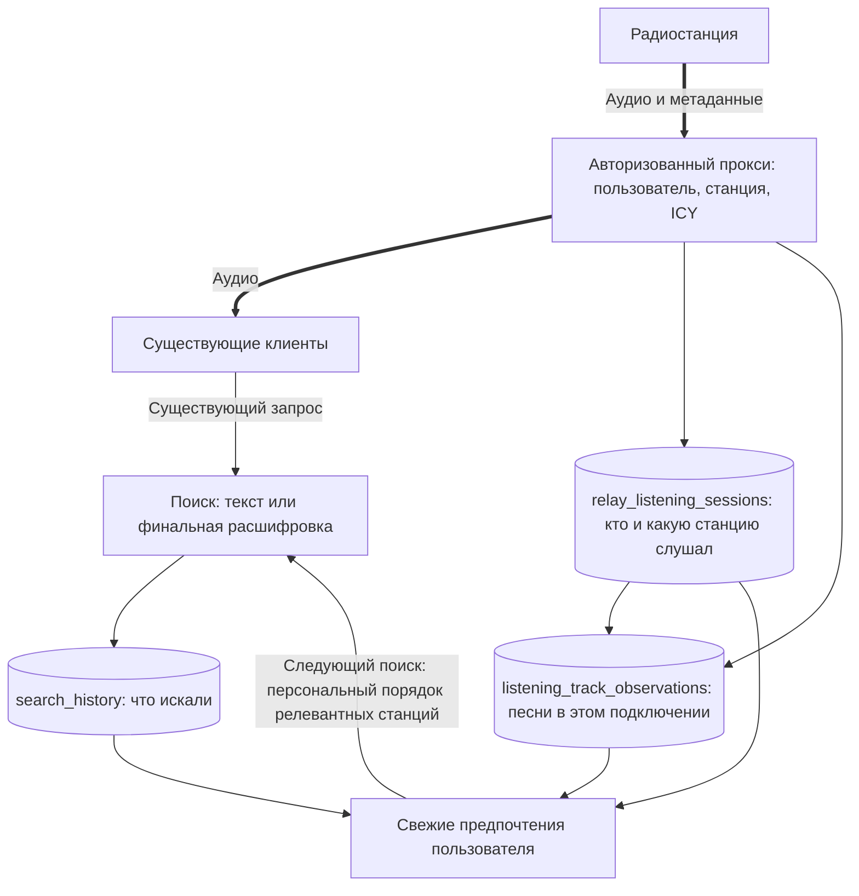

# Поиск и прослушивания — минимальный серверный план

Дата: 2026-10-16. **Статус: предложение, без реализации.**

Эта упрощённая версия заменяет ранее обсуждавшуюся подробную схему событий, показов, переходов и онлайн-профилей. Цель — собрать полезные данные и персонализировать поиск, **не меняя протоколы и интерфейсы существующих клиентов**. Код, миграции и действующий API в рамках подготовки документа не меняются.

## 1. Что сохраняем и зачем

Достаточно трёх фактов:

1. Что и когда искали, кто искал — если сервер знает пользователя.
2. Какому пользователю, какую станцию и в какой период передавал прокси.
3. Какие названия песен сообщал этот поток в течение подключения.

Из них можно получать историю пользователя, предпочтения по станциям и исполнителям, примерный состав эфира и исходные данные для улучшения голосового поиска. Точность песни зависит от качества метаданных радиостанции.

**Персонализация следующего поиска остаётся целью.** Для начала она использует свежие записи этих таблиц; отдельная система событий, таблицы показов, профилей и суточных рейтингов не обязательны.

## 2. Что уже есть, а что предстоит сделать на сервере

Проверено по исходникам и миграциям:

| Источник | Что есть сейчас | Что добавляет будущая реализация |
|---|---|---|
| `src/http/search.rs` | Сервер получает текст, locale, limit/offset и exclusions; публичный поиск может быть анонимным | Сохраняет запрос/нормализованный разбор и определяет пользователя по уже переданным credentials, где это возможно |
| `src/http/voice.rs` | Есть финальная STT-расшифровка; поддерживаются анонимный путь, общий application token и native device identity | Сохраняет финальный запрос; проверенную личность учитывает отдельно от выбора device-control режима |
| `src/http/relay.rs` | Авторизованный доступ по browser/native session, station ID, отдельный upstream на слушателя | Сохраняет проверенные user/device IDs вместо одного результата «доступ разрешён», начало/активность/конец подключения и метаданные этого upstream |
| `src/http/relay/metadata.rs` | Process-local snapshot и SSE станции | Остаётся для UI; историю конкретного слушателя нельзя строить из общего snapshot вместо его upstream |
| Миграции каталога/аккаунтов | `users.id uuid`, `devices.id uuid`, `stations.id varchar(128)`, `station_streams.id bigint` | Новые таблицы ссылаются на существующие сущности |
| `history_records` из миграции 0025 | Отдельная клиентская синхронизируемая история | Сохраняется со своей семантикой; аналитика relay её не заменяет и не складывается с ней как независимое прослушивание |

**Без изменений клиентов не означает без изменений сервера.** Добавляются persistence, optional identity resolution на поиске и пользовательские признаки в поисковом сервисе. Само наличие этих данных в обработчиках ещё не означает, что они сейчас сохраняются.

## 3. Простая архитектура

Все добавляемые блоки на схеме — **план**.



Один RockServer и PostgreSQL. Передача аудио не ждёт записи аналитики: небольшая ограниченная очередь и фоновая пакетная запись в эти таблицы. Без отдельного брокера и универсального журнала событий. При переполнении/падении до записи возможны потери; их нужно учитывать счётчиком и не обещать полную историю.

## 4. Предлагаемые таблицы

Это форматы для обсуждения, а не готовые миграции. `?` означает NULL; время — `timestamptz` в UTC; длительности — миллисекунды. UUID создаёт сервер, новые ID от клиентов не требуются.

### 4.1. `search_history` — что искалось

| Поле | Тип | Смысл |
|---|---|---|
| `id` | uuid PK | Одна серверная операция поиска |
| `user_id` | uuid? | Проверенный пользователь, если доступен |
| `device_id` | uuid? | Native-устройство, если доступно |
| `searched_at` | timestamptz | Время поиска |
| `input_kind` | text | `text` или `voice` |
| `query_text` | text? | Введённый текст или финальная STT-расшифровка; NULL при отсутствии распознанной речи |
| `normalized_query` | jsonb? | Уже полученный структурированный разбор/фильтры, если есть |
| `offset` | integer | Для text paging — фактически запрошенное смещение; для voice — 0 |
| `outcome` | text | `results`, `empty`, `failed`, `cancelled` |

**Запись:** один INSERT после результата/ошибки/отмены серверной операции, если она была принята обработчиком. Не сохранять каждый partial transcript. Каждая страница существующего offset API — отдельная операция, а не новый доказанный интерес к тому же запросу. При оценке предпочтений не усиливать вес за paging/retry; для v1 повторяющийся нормализованный запрос пользователя в небольшом временном окне считается одним слабым сигналом. Это эвристика, точного ID пользовательского намерения старые клиенты не присылают.

Не сохраняем аудио, полную выдачу, показы строк, внутренние STT-тайминги и score каждой станции. Общий application/deployment token не определяет человека.

### 4.2. `relay_listening_sessions` — пользователь и станция

Одна строка — **одно HTTP-подключение к прокси**, а не гарантированное отдельное пользовательское прослушивание.

| Поле | Тип | Смысл |
|---|---|---|
| `id` | uuid PK | Идентификатор подключения |
| `user_id` | uuid | Пользователь из проверенной авторизации |
| `device_id` | uuid? | Native-устройство; у браузера может отсутствовать |
| `station_id` | varchar(128) | Станция каталога |
| `stream_id` | bigint? | Вариант потока, если известен |
| `started_at` | timestamptz | Время первой передачи аудио; без успешной передачи строки прослушивания нет |
| `last_activity_at` | timestamptz | Последнее подтверждённое сервером время передачи |
| `ended_at` | timestamptz? | NULL для активного или ещё не закрытого подключения |
| `end_reason` | text? | `disconnected`, `upstream_error`, `lifetime_limit`, `server_interrupted`; это техническая причина, не оценка вкуса |

**Запись:** INSERT после первых аудиобайтов; периодический UPDATE активности, например раз в 30 секунд; финальный UPDATE при закрытии. Период — предложение, требует оценки нагрузки. После аварии незавершённую строку закрывать по `last_activity_at`, не по времени перезапуска. Небольшой хвост между checkpoints может потеряться.

Для предпочтений учитывать подтверждённые интервалы и объединять наложения одного пользователя/станции, а не считать каждое переподключение независимым положительным голосом. Количество подключений не равно количеству ручных выборов. Не выдумывать объединённую пользовательскую сессию там, где причин reconnect не видно.

### 4.3. `listening_track_observations` — песня в конкретном подключении

| Поле | Тип | Смысл |
|---|---|---|
| `id` | uuid PK | Идентификатор наблюдаемого интервала |
| `listening_session_id` | uuid FK | Ссылка на `relay_listening_sessions.id` |
| `observed_from` | timestamptz | Когда прокси увидел эти метаданные |
| `observed_until` | timestamptz? | Когда сменились/устарели метаданные или закончилось подключение |
| `raw_title` | text | Исходный StreamTitle с ограничением размера |
| `artist` | text? | Исполнитель, если удалось разобрать |
| `title` | text? | Название песни, если удалось разобрать |

**Запись:** INSERT при первом непустом title или его смене; предыдущий интервал закрывается. Повтор того же title не создаёт новый интервал. При потере свежести интервал закрывается по принятой политике свежести; если title затем снова подтверждён, начинается новый интервал. При disconnect закрывается не позже последней передачи аудио. Интервал — приблизительное наблюдение метаданных, а не точные границы студийного эфира.

`user_id` и `station_id` получаем JOIN через сессию — повторять их в каждой строке не нужно. Если ICY нет или строка не похожа на песню, не выдумывать artist/title. Название станции, реклама и название передачи могут попасть в raw_title; не считать каждую строку музыкальным произведением.

Пока у слушателей отдельные upstream, наблюдения хранятся отдельно. Да, одна песня может повториться в строках разных пользователей: это осознанное упрощение вместо сложной канонизации эфира. Для общей картины группировать по станции, разобранному названию и пересекающимся временам, называя результат приблизительным. Нельзя считать количество этих строк числом выходов песни в эфир. Отдельный справочник песен и shared upstream сейчас не требуются.

### Связи и основные индексы

```text
users ──< search_history
users ──< relay_listening_sessions >── stations
                       │
                       └──< listening_track_observations
```

Индексы: `search_history(user_id, searched_at DESC)`, `relay_listening_sessions(user_id, started_at DESC)`, `(station_id, started_at DESC)`, `listening_track_observations(listening_session_id, observed_from)`. Проверять порядок времён, принадлежность device пользователю и ограничивать JSON/тексты. Для удаления каталожных сущностей согласовать FK/архивирование так, чтобы история не мешала обслуживанию каталога.

## 5. Пример: когда что пишется

| Момент | Что сервер уже видит | Запись |
|---|---|---|
| 12:00:00 | Поиск «спокойный джаз без вокала» | После обработки — `search_history`, с user_id только при проверенной личности |
| 12:00:05 | Авторизованному пользователю начал передаваться поток станции A | Новая `relay_listening_sessions` |
| 12:00:07 | ICY: «Artist — Track» | Новая `listening_track_observations` со ссылкой на подключение |
| 12:00:35 | Передача продолжается | Checkpoint `last_activity_at` |
| 12:03:00 | ICY сменился на другую песню | Закрывается прежний интервал, открывается следующий |
| 12:03:20 | Подключение A закрыто | Закрываются подключение и текущий интервал |
| 12:03:21 | Началась передача станции B тому же пользователю | Новая строка подключения B; предположительный переход можно вывести запросом |
| Следующий поиск | Есть свежая история этого пользователя | Сервис учитывает последние запросы и подтверждённое слушание при подборе/ранжировании |

События клиента для этого примера не нужны. Но последовательность A→B не доказывает ручное переключение и не доказывает, что выбор сделан из конкретного поиска.

## 6. Персонализация в реальном времени без отдельной большой подсистемы

В первой версии поиск читает по индексам ограниченную недавнюю историю пользователя: последние запросы и подключения, связанные песни. Считать простые признаки — повторные возвраты к станции, подтверждённое время передачи, знакомые исполнители и явно запрошенные жанры. Запрос сам по себе слабее повторяющегося фактического слушания; отсутствие песенных метаданных не обнуляет интерес к станции.

Лимиты окна и количества записей задаются явно. Для активного подключения брать подтверждённый `last_activity_at`; не наращивать время только потому, что `ended_at IS NULL`. Передачу на одном устройстве не умножать из-за пересекающихся reconnect. Сырая длинная сессия не должна давать неограниченный вес; старые предпочтения постепенно затухают.

Сначала применяются сказанные пользователем ограничения. Затем предпочтения могут добавлять подходящих личных кандидатов и менять порядок релевантных станций. «Включи конкретную станцию» и «без вокала» имеют приоритет над старой историей. Предпочтение исполнителя не сообщает, что он сейчас играет на любой станции: для такого выбора нужны свежие метаданные соответствующего потока.

Свежесть определяется интервалом записи активности и очередью, не суточным отчётом. При checkpoint 30 секунд новый вклад длительности виден примерно с этой гранулярностью плюс задержка записи; изменения title/новые подключения пишутся по мере появления. Это предложенное поведение, не измеренная гарантия. Не требуется непрерывное переобучение LLM.

Для первой версии отдельная таблица профиля не нужна. Если чтение истории станет дорогим, позднее добавить компактный кеш/профиль, обновляемый из тех же фактов, с проверенным сбросом при удалении истории. Падение аналитики не должно блокировать поиск: generic fallback. У пользователя без определённой личности — обычный поиск.

**Постраничная выдача:** обновление предпочтений не должно менять порядок между страницами одной выдачи. При существующем offset API без нового ID клиента потребуется краткоживущий серверный snapshot порядка для проверенного пользователя и параметров запроса либо другой согласованный серверный способ стабилизации. Одинаковые запросы из двух вкладок без correlation ID различить точно нельзя. Это ограничение надо проверить отдельно до включения персонализации в paged-поиске; нельзя просто пересчитывать разные страницы на меняющейся истории. Новая персонализация применяется к новому поиску/обновлению, не самопроизвольно перемешивает UI.

## 7. Что получаем без доработки клиентов, а что остаётся неизвестным

| Вопрос | Ответ |
|---|---|
| Что искалось? | Текст запроса или финальная STT-расшифровка, которую обработал сервер |
| Кто искал? | Только при уже переданной и проверяемой browser/native session; анонимный запрос и общий application token не определяют пользователя |
| Кто слушал станцию через прокси? | Из существующей авторизации relay |
| Какая песня передавалась? | Приблизительно по ICY именно этого подключения, если метаданные есть |
| На какой песне закончилось подключение? | Последнее свежее наблюдение; не точный момент слышимого звука из-за буфера |
| На какую станцию затем подключились? | По соседним подключениям того же пользователя/устройства; предположение, не подтверждённый переход |
| Почему прекратил слушать? | Неизвестно: ручное действие, закрытие приложения, сеть и другие причины могут выглядеть одинаково |
| Выбрал ли станцию из конкретного поиска? | Без ID/события клиента точно неизвестно; близость по времени недостаточна |
| Что реально показали в выдаче и на какой позиции нажали? | Не собираем |
| Что слушали напрямую/офлайн? | Серверный relay этого не видит |

**Граница «без изменений клиентов»:** схема сразу применима к клиентам, которые уже используют relay и передают серверу личную авторизацию. Клиент с прямым воспроизведением не начнёт проходить через прокси только от добавления таблиц. Если клиент не присылает личную сессию в search/voice запросе, сервер может сохранить поиск анонимно, но персонализировать его по человеку не сможет. При необходимости это отдельная небольшая интеграционная задача, а не обязательная новая система аналитических событий для всех клиентов.

На сервере можно распознавать уже приходящую browser cookie/native Bearer без изменения request DTO. Сохранить текущие проверки доверенного proxy, native credential и обработку невалидной авторизации; не использовать IP или общий токен для угадывания личности. Для voice отделить identity аналитики от условий запуска device-control команд, чтобы включение персонализации не меняло смысл голосовых команд.

## 8. Что показать разработчику голосового поиска

Достаточен read-only запрос/обезличенный экспорт из этих трёх таблиц: запросы пользователя по времени, станции и интервалы передачи, исходные/разобранные названия песен. Включать и пустые/ошибочные поиски, неизвестное оставлять NULL.

Это позволяет обсуждать повторные запросы, вкусы по станциям/исполнителям и персональное ранжирование. Этого недостаточно для достоверного CTR, причин переключений или метрики «этот результат поиска понравился»: точной связи выбора с выдачей нет. Для STT без аудио/явной правки также нет эталона правильной расшифровки.

Общую статистику сначала получать SQL-запросами по станции и временному окну. Рейтинг не равен числу подключений, а жанр не выводится уверенно из аудитории или одной raw_title. Автоматический жанр требует подтверждённого источника жанров исполнителя/песни; это последующая задача. Внешнему LLM не передавать личную историю по умолчанию.

## 9. Минимальные эксплуатационные правила

- UUID подключения и наблюдения создаются до постановки в очередь; повтор записи использует тот же ID. Повторный checkpoint не добавляет длительность ещё раз. Порядок данных одного подключения сохраняется, запоздалый UPDATE не открывает закрытую сессию.
- Не писать каждый аудиочанк. Пакетная очередь ограничена; при сбое БД звук продолжается, потери видны в диагностике. На первом этапе нет гарантии восстановления ещё не записанных данных после падения.
- Срок хранения согласовать до реализации; ориентир для обсуждения — 90 дней персональной истории. Удаление истории/аккаунта очищает эти записи и производные кеши; поздняя очередь не восстанавливает их (проверка времени удаления/эпохи на сервере). Учесть существующий soft-delete users. Отключение персонализации и отключение сбора — разные настройки.
- История доступна только владельцу/разрешённому разработчику в минимальном виде. Не хранить credentials, audio, IP для склейки или upstream URL в этих таблицах. Реальные пользовательские выгрузки не коммитить.

## 10. Порядок реализации

1. **MIN-001 — личность и записи.** Проверить, какие существующие text/voice/relay маршруты уже получают личную сессию. Добавить три таблицы и серверную запись. Клиентские события и новые публичные endpoints не нужны.
2. **MIN-002 — чтение и персонализация.** Получать компактную недавнюю историю, добавить ограниченные персональные признаки к поиску, сохранить явные фильтры, fallback и стабильность paging. Проверить задержку/объём на согласованной нагрузке.
3. **MIN-003 — оценка пользы.** Сделать понятные запросы/экспорт для разработчика; проверить историю, исполнителей и ранжирование. Расширять модель только при выявленной нехватке конкретного сигнала.

Критерии проверки будущего кода: без изменений существующих клиентских запросов сохраняются text/voice запросы и relay-история; anonymous остаётся anonymous; метаданные относятся к верному подключению; отсутствие ICY не теряет станцию; reconnect/checkpoint не умножают вес; сбой БД не ломает аудио; следующий поиск учитывает записанную историю, соблюдает фильтры/paging и generic fallback; удаление не отменяется поздней записью. Проверять локальными deterministic fakes, без реальных LLM/сети в unit tests.

**Следующий шаг:** обсудить этот минимальный план с разработчиком голосового поиска, прежде всего существующую передачу identity и простой способ применения предпочтений. Подробные показы, явные переходы, универсальный журнал, отдельные профили и обучение моделей сейчас исключены из первого этапа.
